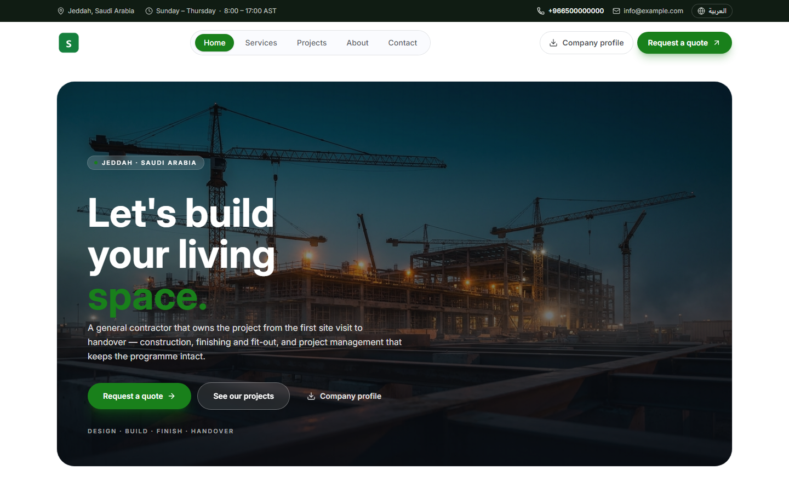
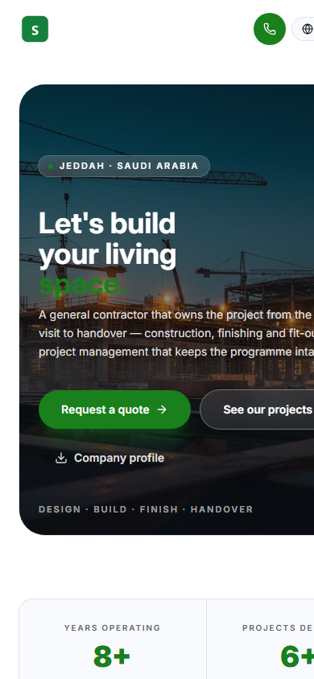

# Sahil — Sahil Contracting Website

Bilingual (English / Arabic) website for **Sahil Contracting Co.** (شركة ساحل للمقاولات), a general contractor in Jeddah, Saudi Arabia, covering construction, finishing and fit-out, interiors and project management.



<p align="center">
  
</p>

## Highlights

- **Full bilingual site.** English and Arabic with complete right-to-left mirroring. The language switch lands on the same page in the other language.
- **Languages cannot drift apart.** The Arabic dictionary is typed against the English one, so a missing key fails the build.
- **One source of truth.** Company facts (phone, WhatsApp, address, hours, stats) live in `src/lib/company.ts` and update the header, footer, forms and structured data together.
- **Portfolio.** A filterable projects grid and six case-study pages with scope, highlights and gallery.
- **Downloadable company profile.** English and Arabic A4 PDFs, generated from print-ready HTML sources in `scripts/`.
- **WhatsApp enquiries.** Forms validate with Zod, show accessible errors in the active language, then open a pre-filled WhatsApp message.
- **SEO.** Canonical URLs, full `hreflang` set, Open Graph share card, sitemap and JSON-LD (Organization, LocalBusiness, Service, BreadcrumbList).
- **Cheap to host.** Prerendered static output with an `.htaccess` fallback for shared hosting.

## Pages

| Route | Content |
| --- | --- |
| `/` | Hero, service lines, selected projects, process, why us, enquiry form |
| `/about` | Story, vision and mission, values, leadership, standards, Vision 2030 |
| `/services` | Four service lines with scope lists |
| `/projects` | Portfolio grid with category filter |
| `/projects/$slug` | Project case studies |
| `/contact` | Contact details, map and enquiry form |

## Tech stack

| Area | Tools |
| --- | --- |
| Framework | React 19, TanStack Start, TanStack Router |
| Build | Vite 7, TypeScript |
| Styling | Tailwind CSS 4, shadcn/ui (Radix UI) |
| Forms | React Hook Form, Zod |
| Hosting | Static prerender + shared hosting (cPanel / Plesk) |

## Project structure

```
src/
  routes/            one file per page
  components/        site chrome and sections
  lib/i18n/          en.ts and ar.ts dictionaries
  lib/company.ts     company facts
  lib/projects.ts    portfolio data
  lib/seo.ts         meta, hreflang and JSON-LD builders
scripts/             company-profile HTML sources, hosting build step
public/              logos, fonts, profile PDFs, share card
```

## Running locally

Requires Node.js 20 or newer.

```bash
npm install
npm run dev
VITE_SITE_URL=https://your-domain.com npm run build
```


## Author

Built by **Ameen Ali Ahmed** — [github.com/AlameenAlii](https://github.com/AlameenAlii)

## License

**All rights reserved.** This code is shown for portfolio viewing only. You may not copy, use, modify or distribute any part of it without my written permission. See [LICENSE](LICENSE).

Client names, logos and content belong to their owners. Open-source dependencies keep their own licenses.
